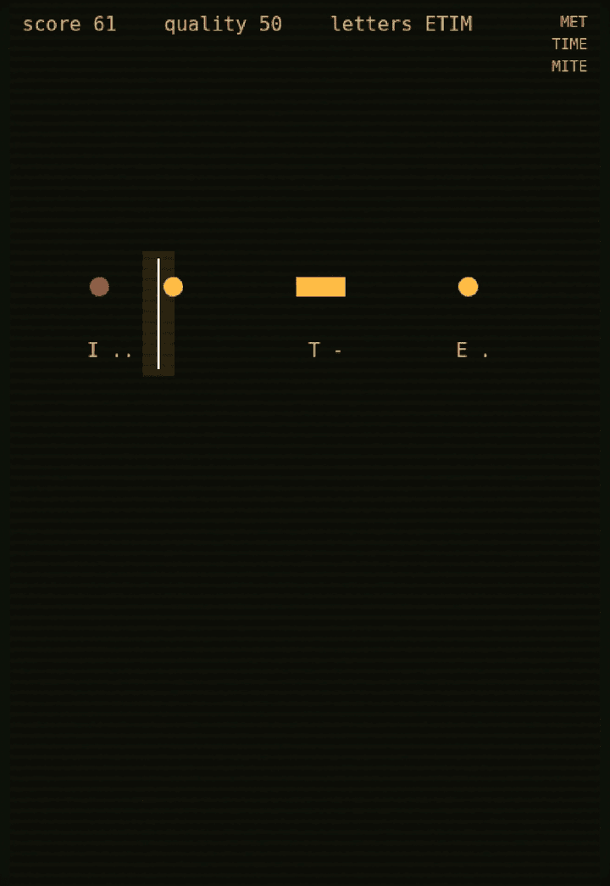

# The Telegraphist

A Morse-code rhythm game about keeping a wartime telegraph line alive.

Signals scroll toward the key line. Tap on the beat for a **dit**, hold for a
**dah**. Letters chain into words, words chain into telegrams, and the line
degrades every time you miss. No Morse knowledge required — the game teaches
letters as you send them.

Made in 48 hours for **Ludum Dare 60**. Play the jam build:
<!-- TODO: paste the ldjam.com entry URL here -->


## Play

```sh
python3 -m http.server 8000
# open http://localhost:8000
```

No build step, no dependencies to install. Everything runs from static files.

On desktop, the stage widens with the window (up to 1280×720 logical); on
phones it uses the original 480×720 portrait layout.

## Controls

| Action | Keyboard | Pointer |
| --- | --- | --- |
| Dit | Tap `Space` / `Enter` / `J` / `F` | Quick tap |
| Dah | Hold `Space` / `Enter` / `J` / `F` | Press and hold |
| Pause | `Esc` or `P` | `[ PAUSE ]` |
| Mute | `M` | — |
| Start / retry | `Space` | Buttons |

A dit is a press under 250 ms; a dah is a press of at least 120 ms. Both must
start within ±250 ms of the signal reaching the line.

## Screens

| Tutorial | Gameplay | Miss |
| --- | --- | --- |
|  |  |  |

## How it works

- `game.js` — the whole game: five Phaser scenes (`Menu`, `Tutorial`, `Play`,
  `Pause`, `Over`), a WebAudio synth for dits/dahs/pads, and a GLSL CRT shader
  for the screen background.
- `style.css` — full-bleed canvas, no scrollbars.
- `vendor/phaser.min.js` — Phaser 4.2.1, vendored so the game runs offline.

Timing uses raw pointer/keyboard timestamps rather than Phaser's input queue,
so hit accuracy isn't inflated by a frame of latency.

## Post-jam work

The jam build is tagged `ldjam-60-submission` and kept as-is. Changes since
then live on `postjam` and are summarised in [docs/feedback.md](docs/feedback.md):
desktop scaling and larger notes, an interactive tutorial with per-note
feedback, a visible beat grid, gentler opening tempo, persisted progress, and a
handful of input/audio fixes.

## Credits

Design, code and sound by [@lloydlobo](https://github.com/lloydlobo).
Built with [Phaser](https://phaser.io/).
