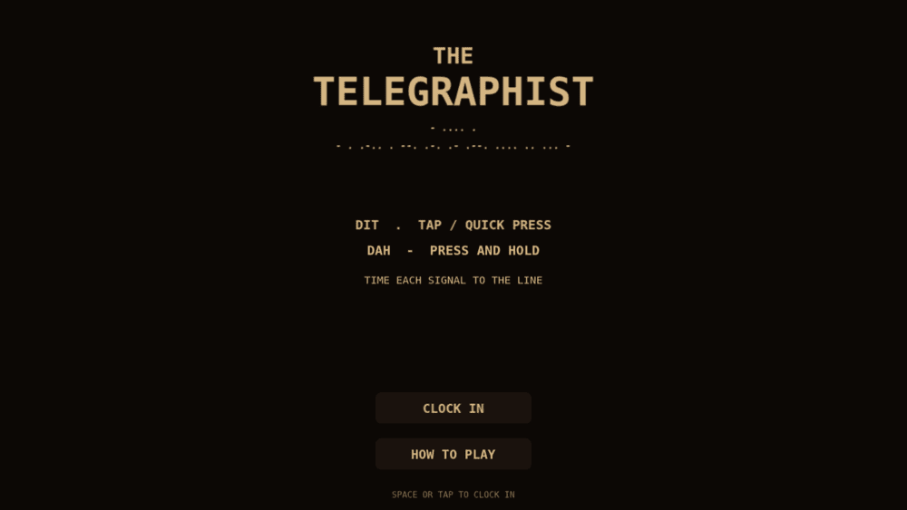
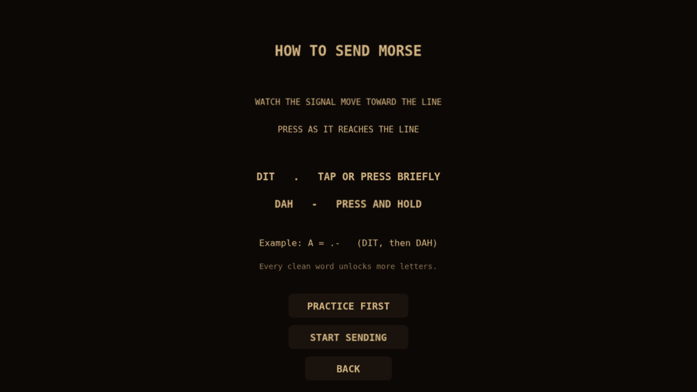
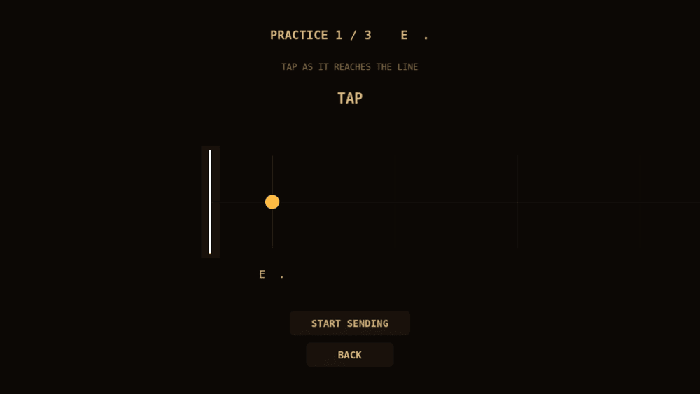
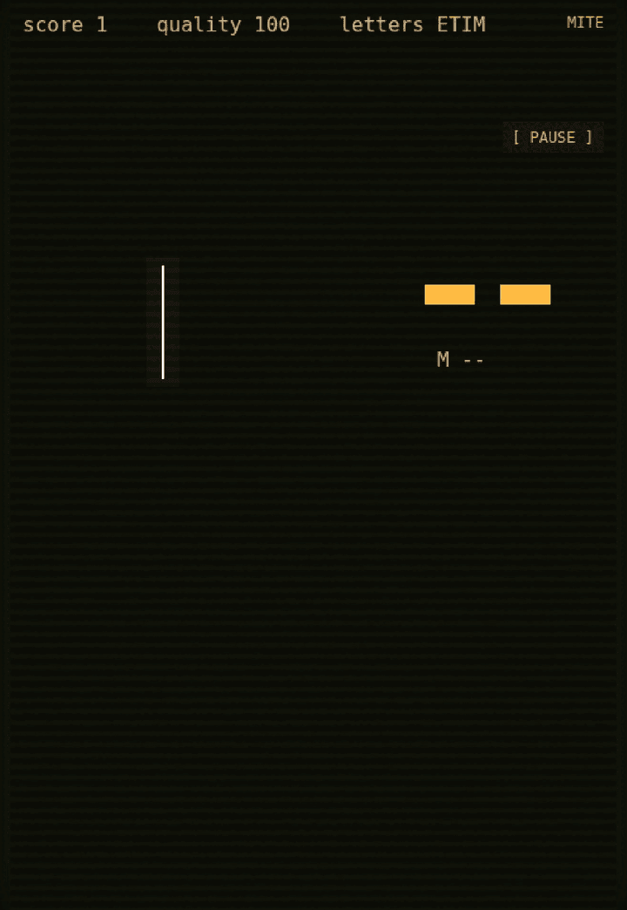

# The Telegraphist

A Morse-code rhythm game about keeping a wartime telegraph line alive.

Signals scroll toward the key line. Tap on the beat for a **dit**, hold for a
**dah**. Letters chain into words, words chain into telegrams, and the line
degrades every time you miss. No Morse knowledge required — the game teaches
letters as you send them.

Made in 48 hours for **Ludum Dare 60** (*The Traffic Jam*). The submitted
build is preserved in this repo under the `ldjam-60-submission` tag.
<!-- TODO: link the ldjam.com entry here when handy -->



## Play

```sh
python3 -m http.server 8000
# open http://localhost:8000
```

No build step, no dependencies to install. Everything runs from static files.

On desktop, the stage widens with the window (up to 1280×720 logical); on
phones it uses the original 480×720 portrait layout.

## Controls

| Action | Keyboard | Pointer |
| --- | --- | --- |
| Dit | Tap `Space` / `Enter` / `J` / `F` | Quick tap |
| Dah | Hold `Space` / `Enter` / `J` / `F` | Press and hold |
| Pause | `Esc` or `P` | `[ PAUSE ]` |
| Mute | `M` | `SOUND` in the pause menu |
| Start / retry | `Space` | Buttons |

A dit is a press under 250 ms; a dah is a press of at least 120 ms. Both must
start within ±250 ms of the signal reaching the line. Every signal is graded —
`PERFECT` inside 90 ms, `GOOD` inside 170 ms — and misses say why
(`TOO LONG`, `TOO SHORT`, `TOO EARLY`, `MISSED`).

## Screens

| Tutorial | Guided practice | Gameplay |
| --- | --- | --- |
|  |  |  |

Screenshots show the post-jam build at 1920×1080. The `ldjam-60-submission` tag
is the original 480×720 portrait jam build.

## How it works

- `game.js` — the whole game: six Phaser scenes (`Menu`, `Tutorial`, `Practice`,
  `Play`, `Pause`, `Over`), a WebAudio synth for dits/dahs/pads, a GLSL CRT
  shader for the screen background, and the telegraph-office artwork painted
  into a canvas texture at boot (no image assets).
- `style.css` — full-bleed canvas, no scrollbars.
- `vendor/phaser.min.js` — Phaser 4.2.1, vendored so the game runs offline.

Timing uses raw pointer/keyboard timestamps rather than Phaser's input queue,
so hit accuracy isn't inflated by a frame of latency.

## Post-jam work

The jam build is tagged `ldjam-60-submission` and kept as-is. Changes since
then are summarised in [docs/feedback.md](docs/feedback.md): desktop scaling and
larger notes, an interactive tutorial with per-note feedback, a visible beat
grid, gentler opening tempo, persisted progress, a handful of input/audio
fixes, and the retro telegraph-office dressing (menu backdrops plus sounder
and telegram-form flavour in play).

## Credits

Design, code and sound by [@lloydlobo](https://github.com/lloydlobo).
Built with [Phaser](https://phaser.io/).
